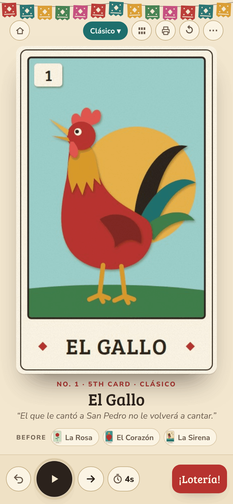
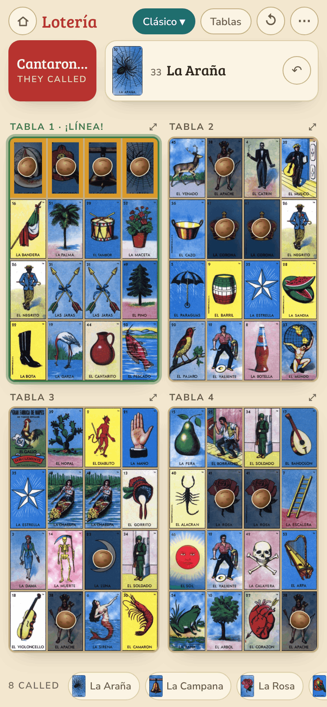
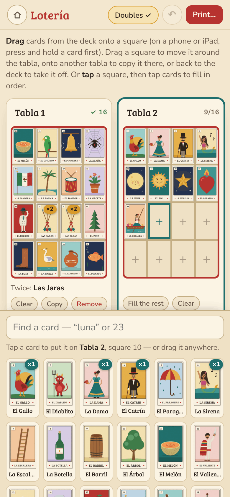

# El Cantor

**Play it: [el-cantor.junkdrawer.works](https://el-cantor.junkdrawer.works/)**

**Lotería for the family table, in one package.** Everything stays on the device, unless you turn on saving to Google Drive so your tablas follow you to your other devices.

<p align="center">
  
  &nbsp;
  
  &nbsp;
  
</p>

Install it from the browser (on an iPhone, Share → Add to Home Screen) and it runs as its own app, named El Cantor whichever page it was added from. It works offline too: installing keeps the card pictures, and once a round starts with a recorded voice, the rest of that voice (about 1.5 MB) comes down quietly in the background, so the next game with no signal sounds the same. It doesn't when the browser says the phone is saving data; Safari never says, so in Safari on an iPhone it comes down in Low Data Mode too (MDN's browser compatibility data: Safari has no `navigator.connection`).

**A browser that keeps nothing** (its storage turned off, or full) says so once on each page, *This browser isn't keeping what you do here (private browsing, or its storage is off or full), so it will be gone when you close it*, and Make tablas and My tablas' About say it in place of saying they save.

**Keeping tablas in Safari.** Safari deletes what a website saved after seven days of Safari use without a visit, while a web app on the Home Screen keeps its own count (WebKit blog, "Full Third-Party Cookie Blocking and More", 24 March 2020). So in a Safari tab on an iPhone or iPad, with Google Drive saving off, My tablas and Make tablas say so in a line, with the two ways to keep the tablas: the Home Screen, or Google Drive. Its × puts it away for good on that device. Every page also asks the browser to keep what it saves (`navigator.storage.persist()`, which Safari 17 grants on signs like being opened from the Home Screen), except in Firefox, which would ask the person first.

The home screen has three choices:

- **El Cantor** (`cantor.html`) calls the game: the phone, tablet or laptop at the head of the table that replaces the deck and the person reading it.
- **My tablas** (`board.html`) is the play-along board: each player marks their own tablas on their phone as cards are called.
- **Make tablas** (`print.html`) makes tablas by hand, with drag and drop, and prints them.

Every page has a ⌂ button back to the home screen. They all load the same `deck.js` and card images.

**English or Español.** The home screen has an **English | Español** switch, and so do the top of Settings in El Cantor and My tablas and the foot of Make tablas. A device's first visit to My tablas has it too, at the foot of who's playing and of a shared link's offer: the offer comes back in the new language with the same tablas, and a name already typed stays. The choice is kept on each device (it doesn't go to Google Drive), and a phone or computer set to Spanish starts in Español. All three tools follow it, and so do the tablas El Cantor prints and what Google Drive saving says, dates included. The card names, the verses and the recorded voices are Spanish either way. A link texted to someone shows its preview in Spanish first, with "In English too.", since a chat app can't know which language the phone is set to.

## How it plays

### El Cantor — calling the game

- **Calls the cards.** Shuffles the 54 cards and turns them over one at a time, calling each one aloud in Spanish. It says just the name by default, or the verse and then the name. Tap ▶, or the card itself, to call on its own and to pause; **Next card** turns them by hand. On a phone, the timer button beside it switches between slow, normal and fast (7, 4 or 2 seconds between cards). If the screen turns off or another app comes up mid-round, calling pauses rather than go on unseen, and when El Cantor is back it says *Paused while the screen was off — tap the card to keep calling*; that tap brings an iPhone's sound back too.
- **Keep the screen on** (Settings, on to start with): from the first card until half an hour after the last, between rounds too, while the beans come off and the next game is picked. A device that won't keep its screen on says so once, with what to do instead: an iPhone app on the Home Screen before iOS 18.4 couldn't, though it seemed to (MDN's browser compatibility data for Screen Wake Lock: "Does not work in standalone Home Screen Web Apps", WebKit bug 254545), so there it says *This phone won't stay awake on its own — set Auto-Lock longer for game night, in Settings › Display and Brightness* (an iPad says *This iPad*), and Settings says the same.
- **¿Cuál?** Tap the card's name under the picture, or press R, and El Cantor says the card again in the chosen voice, then waits its usual time before the next card, so nothing lands on top of it. In Adivinanza it says the verse and the name.
- **Recorded voices.** Dora, Alex or Santa read the cards, so every phone and tablet sounds the same. The device's own Spanish voice is the fallback: a card whose clip hasn't arrived in 3 seconds is read by it, the cards after it that round don't wait for theirs, and one note says *The recorded voice isn't loading — using this device's voice*. On an iPhone it plays even with the silent switch on.
- **Adivinanza** mode reads the verse with the card face down, so the table can guess before it turns over.
- **The sábana** shows all 54 cards, lit in the order they were called.
- **A phone turned sideways**, propped at the head of the table, puts the card on the left, as tall as the screen allows, with its name, its verse and the cards before it on the right; the sábana opens from its button, as it does upright. Every page keeps its buttons clear of the notch and the rounded corners.
- **Full screen** (Settings, or F) hides the browser's tabs and address bar, for a laptop or a TV at the head of the table, and Esc brings them back. It shows only where the browser allows it, so not on an iPhone, where Safari lets only a video fill the screen (MDN's browser compatibility data for the Fullscreen API: "Only available on iPad, not on iPhone"). An app installed on a phone or tablet has no browser bars already.
- **Print tablas** makes a PDF of numbered tablas to print at home, one large or two per page, Letter or A4. A set — a *juego* — is built from its name, so `CANELA` tabla 7 is always the same tabla. Its third choice, **The deck**, prints the 54 cards to cut out instead, for a night without power or signal, or for calling from real cards: 9 to a page on 6 pages, each about 2 × 3.3 in, with a light grey grid to cut along. On a phone, once the PDF is made, its button becomes **Print or send…**, which opens the phone's own share sheet with it: Print, Files, or the family chat. A small **Download** beside it saves it the way a computer does, straight away.
- **¡Lotería!** takes the winner's word by default: a cheer, the winner's name (one tap for past winners), and the next round, which asks what the table plays next (**Done** keeps the game). Before the first card it only says that ▶ starts the round, so a slip of the finger cheers nobody.
  - The box is the moment of the night: cut paper in the papel picado's colours falls over it for a few seconds (not on a device set to reduce motion), and the winner's name has a line of its own, large. On a laptop or a TV the box fills the middle of the screen, to read from across the room. A tabla checked by number comes into the box, its winning line in gold.
  - Tables that check can switch that in Settings, or tap **Check a tabla first**, which brings the name along. The checker keeps **Who won?**, the past winners and **¡Buena! New round** at the bottom of the screen. When a tabla isn't good yet, **Keep calling** is the main button there, and **Count it anyway** still counts the win.
  - To check a printed tabla, type its juego and tabla number. El Cantor shows the tabla with beans on the called cards, whether it wins the current game (the winning line outlined in gold), and when it first did. It remembers the juego, so the next check opens on it, ready for a number. It knows how many tablas it printed of a juego too, so a number past them, *dieciséis* heard as *sesenta*, gets “CANELA was printed with 12 tablas — check the number” under the verdict.
  - For store-bought tablas, tap the cards the player reads out instead. Until they've read out half as many cards as the game has squares (a card covers two at most, as a double), it says how many squares the game needs and to keep tapping, so two cards are never “good” at Tabla Llena; short of all of them, it's good only with doubles on their tabla, and says so.
  - **House rules** in Settings (*Reglas de la casa*). **Two ¡Lotería!s on the same card** has three ways, and after a ¡Lotería! (in the box that takes their word, and after **¡Buena!**) **+ Another winner on this card** adds the next one before anything is shuffled:
    - **Keep calling, the next card decides**, the choice it starts on: the tied players keep playing, and the first of them to have a card called on their tabla wins. El Cantor says who is tied in a line above the card and keeps calling. When it knows every tied tabla (a printed tabla it checked by number), it decides each card by itself; a card on more than one of them leaves those tied and calling goes on. When it doesn't (card by card, store-bought tablas, or taking their word), it asks after each card, *Who has El Gallo?*, with a button for each tied player and **Neither, keep calling**; ¡Lotería! asks the same about the card just called. If no card still to come can be on a tied tabla (Tabla Llena, or the end of the deck), they share the round. Putting cards back past the tied card calls the tie off.
    - **They share the round**: each gets the round in the tally, and Settings lists it once, *Ana and Beto · shared*.
    - **First to shout wins**: one winner, as before.
    - Tonight's standings count the tie-break's winner once, and each of those who share once. A winner who waits for the others isn't saved until the round is settled, and Escape leaves that box up.
  - **A late ¡Lotería!**, the second house rule, starts on **Counts**. Families who must shout before the next card can choose **Too late after the next card**: then a checked tabla that was already good two or more cards back gets *Too late — it was good on La Luna, 3 cards ago*, with **Keep calling** as the main button and **Count it anyway** still there. The card just called and the one before it both still count, to allow for the pace; card by card goes by the last of the cards the player reads out.
- **Games:** Clásico (4 in a row, 4 corners, or 4 in a square), or a single shape. The shapes are Línea (any row, column or diagonal, the line many families call a *chorro*), Esquinas, Centro, Cuadrito, La Ele, La Equis, El Marco, Rieles, Escalera, Siete Loco and Tabla Llena. Hold a shape for a second to add it to the game; then a tabla wins on any one of them. Clásico already wins with every shape but Siete Loco, so on Clásico only Siete Loco goes on top (**Clásico + Siete Loco**), and holding another one says so. The game being played shows where the whole table can see it: over **Ready when you are** with each shape's little diagram and what it takes, beside the sábana's title on a laptop, tablet or TV, and on a phone in the line over the card's name.
- **Keeps a tally** of who won each round, night by night. Wins less than six hours apart are one night, and a new night starts the round numbers again at 1 (a round left from the night before shows as round 1, and so does a new one shuffled before a card of it is called). Under the winner, both ¡Lotería! boxes say how the night stands: *Abuela 2 · Mark 1 tonight*. Settings has tonight's tally and rounds, then the earlier nights by date; its **Clear** empties the winners and starts the rounds again at 1. A name counts once whatever its capitals: typed the way a past winner's was, "abuela" is saved as "Abuela", and a name first saved as "abuela" becomes "Abuela" once someone types it with its capital.

Keyboard: Space starts or pauses · → next card · ← puts the last card back · R says the card again · L checks a ¡Lotería! · F full screen · Enter in **Who won?** counts the win (a phone's Go key does the same)

### My tablas — playing along

Someone calls the cards; you tap **Cantaron…**, pick the card, and it marks itself on every tabla where it appears. Its box finds a card by name or number, the card it names first, so “sol” and Enter is El Sol, not El Soldado, as in the checker and Make tablas. A card picked again stays marked. To take one back, tap its square or its name in the row of called cards, or ↶ for the last one.

- Pick the game each round: Clásico, or a single shape, the same list El Cantor uses.
- A win cheers, throws El Cantor's cut paper (not on a device set to reduce motion), outlines the tabla and says what to tell the caller: *juego CANELA, tabla 7* for a tabla added with **+ A printed tabla**, so El Cantor can check it by number, or else the winning cards to read out (just "the cards with a bean" for a big shape like Tabla Llena). Its **New round** asks before it takes the beans off, as ↺ does.
- **Keep the screen on** in Settings, as in El Cantor: on while a round is being played, until half an hour after the last card marked, so a phone with nothing to mark for a while doesn't lock.
- Edit tablas square by square. Doubles are fine (family rule) — when that card is called, both squares get a bean — but not three of a card. Up to six tablas per person.
- **Random tabla** deals 16 different cards, with no double, as a start to edit from. Make tablas' **Random** makes one like Mark's four instead.
- **+ A printed tabla** adds a tabla from El Cantor's printed juegos by its name and number. It starts with the juego El Cantor last printed or checked on this device.
- **The first visit** asks who's playing on the device, over an empty board, as nothing there is anyone's yet: a name, which it waits for, and two random tablas to edit or Mark's four to start with. **Not now** goes back to the home screen without saving anything, and the question comes back next time.
- Several people on one device, each with their own tablas. The name of whoever is playing takes the place of the Lotería title at the top, and a tap on it switches to someone else.
- **Share** makes a link that carries someone's tablas to another phone, six at most (a link with more brings its first six). A link that arrives with a full stop or bracket after it, or with its ~ turned into %7E by a mail app, still opens; one cut short on the way says so, *This link didn't come through whole — ask for it to be sent again*. The phone that opens it shows those tablas before anything is saved. On a phone nobody has set up, it asks whose they are, with the link's name filled in to keep or change. For someone already on the phone, whatever the capitals, it adds the link's tablas after theirs, leaving out any they already have, up to six (one named like one of theirs comes in as the next Tabla number); **Replace** puts the link's in place of theirs instead, on a second tap.
- **Paste a share link** in Settings (or, on a first visit, under Who's playing) takes the link, or the whole message it came in, and offers its tablas as a tapped link does. It's for El Cantor on an iPhone's Home Screen, which keeps its own tablas apart from Safari's, where a tapped link opens (WebKit bug 181849). So in a Safari tab on an iPhone or iPad, a shared link's offer says how to take it there, with **Copy link**.

### Make tablas — by hand, to print

- Drag cards from the deck onto a tabla. On a phone or iPad, press and hold a card before you drag it. Drag a square to move it, onto another tabla to copy it, or back to the deck to take it off. You can also tap a square and then tap cards. A card tapped with no square picked goes on the tabla in view, and on to the next tabla with room once that one is full.
- **Doubles ✓** is the family rule: a card can go on a tabla twice, but not three times. **Random** makes a tabla like Mark's four, with 15 cards and one of them twice, side by side in the middle. Turn it off to allow each card only once.
- A double covers two squares, so a tabla with one needs a card fewer for some shapes and wins a little more often than a tabla without, most at Centro, where the double sits. Among Mark's four, which all have one, it evens out.
- **Print…** fits 1, 2 or 4 tablas on a Letter or A4 page. With 2 per page the tablas print sideways.
- Copy in Mark's four, or anyone's tablas from My tablas on this device. **Play these in My tablas…** sends full tablas there, on this phone or another: six at most, picked under **Which tablas** as in Print…, with the first six picked to start.
- Hand-made tablas aren't numbered, so El Cantor checks them card by card. For a set it checks by number, use El Cantor's **Print tablas**.

## Saving to Google Drive

Anyone can turn this on from the home screen, from Settings in My tablas or El Cantor, or from the bottom of Make tablas. It needs a Google account, and each person's tablas go to their own Drive. Everyone who signs in with the same account shares one set.

- **What's saved:** the people and tablas in My tablas, the tablas in Make tablas, El Cantor's winners, the juego it last printed or checked, and how many tablas it printed of each juego. Called cards, voices and other settings stay with each device.
- **Where:** one file, `Lotería tablas.json`, in a `Lotería` folder in the person's Google Drive. The app asks only for `drive.file`, Google's narrowest Drive permission: the junkdrawer.works apps can open only the files they made, and nothing else in Drive. Deleting the folder removes the Drive copy; the next sync makes a new one from whatever the device has.
- **How changes combine:** each device keeps working from its own copy and syncs when a page opens, a few seconds after a change (or straight away if the page is left before then), when the connection comes back after a failed sync, and when **Sync now** is tapped. Changes merge one tabla at a time, so edits on two devices both survive; if the same tabla changed on both, the newer change wins. The first time a device joins, nothing is thrown away: someone set up under the same name on both devices becomes one person with the tablas from both, spelled the way Drive already has it ("Mark", even if the new phone said "mark").
- **The one-hour rule:** Google lets a website with no server of its own use Drive for an hour after signing in. After that, the ☁ button in My tablas and Make tablas shows a red dot, as soon as the hour runs out on a page left open. Tap it once to sync again; it usually goes by without asking anything. El Cantor has no ☁ button, so a winner it saves after the hour says it's saved here for now, and **Sync now** in its Settings sends it.
- **When something goes wrong,** the ☁ button's dot turns red, and a tap on it, or on **Sync now**, says what happened for a few seconds, in the language chosen: no connection (the tablas are kept on the device and sync once it's back online), a full Google Drive (nothing new is saved there until some space is freed), Drive busy (it tries again by itself a minute later), or Google's sign-in not loading. The Google Drive card in Settings says the same, with **Sync now** to try again.
- **A damaged Drive copy** (emptied, cut short, or missing a part) is put right by the first device to sync, from what can still be read and what that device has. Every other device then merges with it once as it did when it joined, so a tabla the damage hid comes back from whichever device has it. A copy saved by a newer El Cantor is left as it is, and the device says to close El Cantor and open it again to update.
- **Stop saving on this device** turns it off here, even in the middle of a sync, which then goes no further. The tablas stay on the device and in Drive. Turning it on again opens Google's account chooser, so a family tablet can move to someone else's Drive.

### Setting it up

`sync.js` uses the junkdrawer.works OAuth client that Shelfmark and Terraville also use. It is authorized for `https://el-cantor.junkdrawer.works` (and for `https://junkdrawer.works`, where El Cantor used to live), and Drive saving shows only there. All three apps ask for the same permission, `drive.file`, so there's nothing to add in Google Cloud, and approving it once covers every app.

Things that come with sharing the client:

- **One sign-in for the hour.** The Google sign-in is kept under the `junkdrawer.google` key in localStorage, the same key every junkdrawer.works app uses. Each app has its own address now, so each keeps its own copy: a sign-in lasts the hour here, and the next one remembers the account.
- **No revoking.** **Stop saving on this device** turns saving off here without revoking anything, because revoking cancels the permission for every app on the client.
- **Files are found by tags, not names.** Each app's files carry `appProperties` naming the app (`loteria: 'folder'`, `loteria: 'sync'`), and the app searches by those, so apps sharing the client never pick up each other's files.

To run it from another address, create a Web client with the Drive API turned on and `drive.file` allowed, add that origin under **Authorized JavaScript origins**, and put the client ID and origin in `sync.js`.

## Running it

It's a static site: plain HTML, CSS and JavaScript, with no build step. It runs from any static host as it is.

```sh
npx serve .                   # or any static file server, then open the printed address
npm test                      # checks the game's logic, then uses the three tools in Chromium through the real pages (needs Playwright)
npm install                   # once, for the screenshots
node tools/screenshots.mjs    # redraws the pictures in docs/ and og.png, the link preview
node tools/make-icons.mjs     # redraws the PNG icons from icon.svg
```

To put it online with GitHub Pages: **Settings → Pages → Build and deployment → Deploy from a branch**, then pick `main` and `/ (root)`.

### Files

- `index.html` — the home screen.
- `cantor.html` — El Cantor.
- `board.html` — My tablas, the play-along board.
- `print.html` — Make tablas.
- `carry.js` — the first time it opens at el-cantor.junkdrawer.works, brings the tablas saved at its old address, junkdrawer.works/el-cantor/.
- `strings.js` — every word the app shows, in English and in Spanish, and the English / Español setting. Change a wording in both languages: `npm test` fails when a word is missing in either one, or is there but used nowhere.
- `manifest.webmanifest`, `icon.svg` and the `icon-*.png` sizes — installing it as an app. `node tools/make-icons.mjs` redraws the PNGs from `icon.svg` and `tools/icon-full-bleed.svg`.
- `sw.js` — the offline copy: the pages, the fonts, the card pictures, and the recorded voice in use, which El Cantor brings down once a round starts. On a connection that isn't answering, a page opens from that copy after four seconds. `FILES` in it is a fingerprint of the files it keeps: change one and `npm test` says what to set it to, so a release never leaves the copy half old.
- `sync.js` — saving to Google Drive: signing in, the Drive file, and merging changes from every device. Also the Safari line, and keeping the screen on, which El Cantor and My tablas share.
- `deck.js` — the cards, their verses, the winning shapes, Mark's four tablas, and the juego generator. Every page loads it.
  - The generator is frozen: changing it would change every tabla already printed.
- `cards/` — the 54 card images, drawn for El Cantor.
- `fonts/` — Bree Serif and Nunito Sans (SIL Open Font License), served from here so nothing loads from elsewhere.
- `tools/cards/` — draws the cards.
  - Each card is an SVG in a cut-paper style, written in Python: `card.py` is the template and shared pieces, and `art1.py` to `art5.py` hold the pictures.
  - `python3 tools/cards/build.py` writes the SVGs, then `node tools/cards/render.mjs` (with [Playwright](https://playwright.dev)) turns them into `cards/*.jpg`. Rerun both after changing a card; `build.py 8,37` draws just those numbers. The names are written in the Bree Serif in `fonts/`, so nothing is fetched, and the tool stops if the font didn't load rather than draw them in another one.
- `audio/` — the recorded voices.
  - One clip per card: the verse, a breath, the name. Plus the opening line and ¡Lotería!
  - `voices.json` lists the voices and where each verse ends, so Adivinanza can stop before the name.
- `tools/make_voices.py` — renders `audio/` with [Kokoro-82M](https://github.com/hexgrad/kokoro) (Apache-2.0), using espeak-ng's Latin American Spanish for pronunciation. Rerun it after changing a verse in `deck.js`; the usage is at the top of the script.
- `tools/screenshots.mjs` — draws the pictures in `docs/`, with each tool opened on the same saved tablas every time, and `og.png`, the link preview, from the home screen's banderitas, the line in `index.html`'s `og:description` and four of the cards. Run it again when the cards, that line or the look change. It saves them with 256 colours using upng-js, from `npm install`.
- `test/logic.mjs` — what `npm test` runs first, in a few seconds and with no browser: the juegos' rules across many names (16 different cards, no two tablas alike, the deck dealt out evenly, no Clásico four printed twice), every winning shape checked against the rules with doubles, when a printed tabla first won, the random tablas' rules, and the shuffle's fairness.
- `test/e2e.mjs` — what `npm test` runs next: El Cantor, My tablas and Make tablas used through the real pages in Chromium, El Cantor's PDFs read back card by card, a recorded voice calling a round, two devices saving to a stand-in Google Drive (`test/fake-google.mjs`), the first visit bringing tablas from the old address, every page offline, and the words: each one in English and Spanish, and the screens in Spanish swept for English left behind. It runs Chromium in US English, whatever the computer's language, and so does `tools/screenshots.mjs`.

## License

The code, the card art and the recorded voices are MIT — see [LICENSE](LICENSE).
